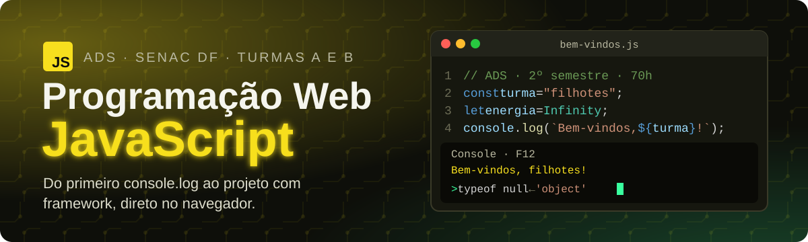

<p align="center">
  
</p>

<p align="center">
  
  
  
  
</p>

<p align="center">
  <b><a href="https://maristelaoliveira.github.io/prog-web-js/">🌐 Abrir o site da disciplina</a></b>
  &nbsp;·&nbsp;
  <b><a href="https://maristelaoliveira.github.io/prog-web-js/#aulas">📚 Ir direto para as aulas</a></b>
  &nbsp;·&nbsp;
  <b><a href="https://maristelaoliveira.github.io/prog-web-js/curso/">⚡ Abrir o curso interativo</a></b>
</p>

---

## `> console.log("Prazer!")`

Prazer, eu sou a **Profa. Maristela**, ou só **Stela**! 👋

Boas-vindas à **Programação Web em JavaScript**, do curso de **Análise e Desenvolvimento de Sistemas** da Faculdade de Tecnologia e Inovação Senac DF (2º semestre, turmas A e B, 70 horas: 60h presenciais e 10h EAD).

Este repositório é o **site da disciplina**: o lugar onde ficam as aulas, os tutoriais, o curso interativo, os exercícios e o quiz de revisão. Nada de slides: aqui a aula é o próprio site.

Abra o console do navegador (`F12`) e veja com os próprios olhos:

```js
> const turma = "filhotes";
> let energia = Infinity;
> console.log(`Bem-vindos, ${turma}!`);
Bem-vindos, filhotes!

> typeof null
'object'          // um bug de 1995 que nunca foi corrigido 🤷

> 0.1 + 0.2
0.30000000000000004   // não é o JavaScript errando: é a matemática dos bits
```

> ⚡ Curiosidade: o JavaScript nasceu em cerca de 10 dias, em 1995, e o "Java" do nome foi só marketing. São linguagens diferentes.

---

## 🧭 O que tem no site

| | Seção | Para que serve |
|:-:|---|---|
| 🔬 | **Raio-X do JavaScript** | O que a linguagem faz na página, com seis curiosidades (e o famoso `typeof null`). |
| 📜 | **Ementa e objetivos** | A ementa oficial e aonde a gente quer chegar. |
| 🧩 | **Conteúdo programático** | As cinco unidades, do console ao framework. |
| 📚 | **Aulas** | Uma página por encontro, com problema, conceitos, tutorial passo a passo, estudo de caso e checklist. |
| ⚡ | **Curso interativo** | Oito módulos com explicação direta, editor de código ao vivo e quiz. O seu progresso fica salvo no navegador. |
| 🛠️ | **Tutoriais** | Passo a passo para construir do zero, começando por uma calculadora simples. |
| 🧪 | **Exercícios e modelos** | Variáveis, operadores lógicos, `else if` e repetição, mais arquivos prontos para começar. |
| 🕹️ | **Quiz de revisão do 1º bimestre** | 20 questões sobre os módulos 1, 2 e 3, com explicação em cada resposta. Começa com o login do e-mail da faculdade. |
| 📊 | **Avaliação** | Como a nota é montada nos dois bimestres. |
| 📖 | **Bibliografia** | Os livros da biblioteca, todos em e-book. |

---

## 🗺️ A trilha do semestre

Cinco unidades, do primeiro `console.log` ao framework. Em JavaScript, fica assim:

```js
const trilha = [
  "Unidade 1 · fundamentos: variáveis, tipos e operadores",
  "Unidade 2 · decisão e repetição (if, switch, for, while)",
  "Unidade 3 · funções e arrow functions",
  "Unidade 4 · arrays, objetos, DOM e eventos",
  "Unidade 5 · frameworks: React na tela, Node.js no servidor",
];

trilha.forEach((unidade, i) => console.log(`${i + 1}. ${unidade}`));
console.log("🏁 Projeto integrador no ar!");
```

| Aula | Tema | |
|:-:|---|:-:|
| 01 | Conhecendo a disciplina | [abrir](https://maristelaoliveira.github.io/prog-web-js/aulas/aula-01.html) |
| 02 | Como os sites executam comandos? (introdução ao JavaScript) | [abrir](https://maristelaoliveira.github.io/prog-web-js/aulas/aula-02.html) |
| 03 | Variáveis e tipos de dados: guardando informações | [abrir](https://maristelaoliveira.github.io/prog-web-js/aulas/aula-03.html) |
| 04 | Desenvolvendo uma calculadora inteligente (operadores) | [abrir](https://maristelaoliveira.github.io/prog-web-js/aulas/aula-04.html) |
| 05 | Como um sistema toma decisões? | [abrir](https://maristelaoliveira.github.io/prog-web-js/aulas/aula-05.html) |
| 06 | Repetindo tarefas automaticamente | [abrir](https://maristelaoliveira.github.io/prog-web-js/aulas/aula-06.html) |
| 07 | Cadastro de Alunos, parte I: organizando o código com funções | [abrir](https://maristelaoliveira.github.io/prog-web-js/aulas/aula-07.html) |
| 08 | Avaliação do 1º bimestre | [abrir](https://maristelaoliveira.github.io/prog-web-js/aulas/aula-08.html) |
| 09 | Como organizar grandes volumes de dados? Arrays | [abrir](https://maristelaoliveira.github.io/prog-web-js/aulas/aula-09.html) |
| 10 | Cadastro de Alunos, parte II: objetos e JSON | [abrir](https://maristelaoliveira.github.io/prog-web-js/aulas/aula-10.html) |
| 11 | Conhecendo o DOM | [abrir](https://maristelaoliveira.github.io/prog-web-js/aulas/aula-11.html) |
| 12 | Tornando páginas interativas: eventos | [abrir](https://maristelaoliveira.github.io/prog-web-js/aulas/aula-12.html) |
| 13 | Frameworks JavaScript: seminários relâmpago | [abrir](https://maristelaoliveira.github.io/prog-web-js/aulas/aula-13.html) |
| 14 a 18 | React, Node.js e GitHub Pages, projeto integrador, apresentação e encerramento | em breve |

---

## 🖥️ Tutorial com cara de VS Code

Da aula 9 em diante, o tutorial de cada aula roda num editor com cara de VS Code, dentro da própria página. Cada passo tem três caixas:

```text
✅ Faça assim         → o código completo, pronto para copiar e rodar
🧪 Teste             → erros de propósito, para ver o que acontece
🚀 Agora é com você  → um desafio para fazer sozinho
```

E cada item do checklist da atividade diz qual passo mostra como fazer. Travou? "Veja o passo 3". 😉

---

## 🛠️ Ferramentas da disciplina

<p align="center">
  
</p>

| Ferramenta | Para quê |
|---|---|
| 🧭 **Navegador e console** (`F12`) | Rodar o JavaScript e ver o que acontece. O F12 vai virar seu melhor amigo. |
| 💻 **VS Code** com **Live Server** | Escrever o código e ver a página atualizar sozinha. |
| 🎓 **NetAcad · JavaScript Essentials 1** | A trilha que o curso interativo acompanha (e simplifica). |
|  **GitHub** e **GitHub Pages** | Guardar o projeto, fazer commit e publicar o site. |
| 📘 **MDN Web Docs** | A documentação oficial, em português, para consultar sem medo. |
| ⚛️ **React** e 🟢 **Node.js** | O mapa do mercado: framework na tela e JavaScript no servidor. |
| 💬 **Teams** e **Moodle** | Combinar, tirar dúvida e entregar. |
| 🤖 **GitHub Copilot** e **Copilot do Microsoft 365** | Para codificar, depurar e revisar, com senso crítico. |

> 🤖 **IA com consciência:** o Copilot entra **depois** de você. Primeiro você pensa e escreve; depois a IA revisa e explica. Ela é assistente de estudo, não substituta do seu raciocínio. E se a sugestão parecer boa demais, confira: a IA também erra. 💪

---

## 📊 Como a nota é montada

| 1º bimestre (10 pontos) | | 2º bimestre (10 pontos) | |
|---|:-:|---|:-:|
| Prova objetiva | 6,0 | Atividade avaliativa prática | 7,0 |
| Atividade avaliativa prática | 4,0 | Avaliação Integrada | 2,0 |
| | | Participação na Jornada Interdisciplinar | 1,0 |

Para ser aprovado: **média final 6,0** e pelo menos **75% de frequência**.

```text
Uncaught TypeError: aluno.aprovar is not a function
    at semestre.js:18
    motivo: frequência abaixo de 75%
```

> Esse erro a gente não quer ver no console. Venha às aulas! 😉

---

## 🙋 Dicas de sobrevivência

1. **Abra o console antes de pedir socorro.** A mensagem vermelha diz o arquivo e a linha.
2. **Use `===`, não `==`.** Em JavaScript, `"1" == 1` dá `true`. Não confie.
3. **`console.log` estratégico.** Na dúvida sobre o valor de uma variável, imprima.
4. **Teste com dado errado de propósito.** Campo vazio, número negativo, letra no lugar de número.
5. **`const` primeiro, `let` quando precisar mudar.** E esqueça o `var`. 🙃
6. **Travou?** Pergunte no Teams. Ninguém nasce sabendo `addEventListener`.

---

<details>
<summary><b>👩‍🏫 Para a professora (estrutura do repositório)</b></summary>

<br>

Site estático publicado no GitHub Pages a partir da branch `main`, sem build e sem dependências.

```text
prog-web-js/
├── index.html                # página da disciplina (raio-x, ementa, conteúdo, aulas, avaliação, atividades)
├── aulas/
│   └── aula-NN.html          # uma página por aula
├── curso/                    # o curso interativo
│   ├── index.html            # página inicial dos 8 módulos, com a barra de progresso
│   ├── modulos/NN-tema/      # um módulo por pasta (explicação, editor ao vivo e quiz)
│   ├── tutoriais/            # calculadora simples e calculadora com HTML, CSS e JS
│   ├── exercicios/           # exercícios e modelos para copiar
│   ├── quiz/                 # quiz de revisão do 1º bimestre (perguntas em js/questoes-revisao.js)
│   └── js/playground.js      # editor ao vivo, exercícios corrigidos e criarProjetoVS()
└── assets/
    ├── css/                  # visual comum dos sites da Stela; aula.css e editor-vs.css (o editor com cara de VS Code)
    ├── js/                   # aula-NN-projetos.js (os passos do tutorial), conta.js (login e registro do quiz)
    └── img/                  # ícones, logo e o banner deste README
```

- Aula nova: copie uma página de `aulas/`, ajuste o conteúdo e ligue o link na lista de aulas do `index.html`.
- Tutorial no editor: os arquivos de cada passo ficam em `assets/js/aula-NN-projetos.js`.
- Pergunta nova no quiz de revisão: `curso/js/questoes-revisao.js`.
- Antes de publicar: testar no navegador, também na largura de celular (390 px).

</details>

---

<p align="center">
  Feito com ♥ e sucata eletrônica pela <a href="https://maristelaoliveira.github.io/">Profa. Maristela</a> · Faculdade de Tecnologia e Inovação Senac DF
  <br>
  <code>console.log("bons estudos!");</code>
</p>
